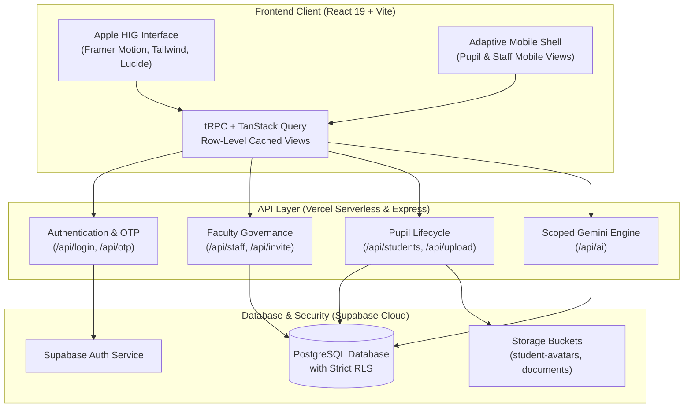

# Global Kids School ERP

<p align="center">
  
</p>

<p align="center">
  <strong>Next-Generation School Management & Academic Intelligence System</strong>
</p>

<p align="center">
  <a href="https://ggs-erp.vercel.app"></a>
  
  
  
  
</p>

---

## Overview

**Global Kids School ERP** is an institutional operating system designed with **Apple Human Interface Guidelines (HIG)** aesthetic precision, strict multi-tenant data governance, and intelligent workflows. Built on macOS Sequoia and iOS 18 design foundations, the system pairs deep dark canvases, authentic frosted glass shaders, and physics-based spring animations with an enterprise-grade academic engine.

Live platform: **[https://ggs-erp.vercel.app](https://ggs-erp.vercel.app)**

---

## Key Highlights

- **Apple HIG Design Engineering**:
  - Calibrated deep-black background (`#08090a`) with multi-layered specular highlights.
  - Authentic frosted glass materials (`backdrop-filter: blur(...) saturate(...)`) engineered to eliminate background distortion on mobile and desktop viewports.
  - Portal-rendered dropdown popovers (`createPortal`) with real-time viewport collision detection and scroll-anchored positioning.
  - Tuned physics-based springs powered by Framer Motion.

- **Granular 8-Tier Role-Based Access Control (RBAC)**:
  - Cryptographically isolated access boundaries ensuring users only see the data their jurisdiction permits.
  - Dedicated portals for School Leadership, Educators, Operational Staff, Students, and Guardians.

- **Unified USN & Two-Factor Authentication**:
  - Direct sign-in via Unique Student/Staff Numbers (USN) or verified email addresses.
  - Automated credential provisioning for new faculty and students with single-use verification links.
  - Timed cryptographic OTP challenge-response pipelines for sensitive role transitions.

- **Academic Operations & Student Records**:
  - Comprehensive student lifecycle management: admissions, section assignments, guardian contacts, and blood group records.
  - Direct Supabase Storage photo pipeline with high-resolution image compression and automated previews.
  - Multi-criteria smart filtering with instantaneous state persistence.

- **Financial Ledger & Fee Collections**:
  - Tuition and activity fee scheduling, digital UPI reference tracking, and downloadable payment receipts.
  - Automated invoice reconciliation with real-time status indicators.

- **Role-Scoped AI Assistant (Gemini)**:
  - Embedded AI assistant utilizing Google Gemini with client-sealed credentials.
  - Dataset scoping engine ensuring the assistant never discloses data outside the authenticated user's permission boundaries.

---

## System Architecture



---

## Role Matrix & Access Boundary

| Role | Target Persona | Scope & Permissions |
| :--- | :--- | :--- |
| **Super Admin** | School Board & Founders | Full governance over all schools, staff credentials, billing ledgers, and raw audit trails. |
| **Admin** | Campus Operations Officers | Student admissions, faculty creation, academic calendar schedules, and class assignments. |
| **Principal** | Head of Institution | Academic analytics, teacher performance reviews, curriculum tracks, and attendance statistics. |
| **Teacher** | Class & Subject Faculty | Gradebook scoring, daily attendance registers, subject notes, and assigned classroom rosters. |
| **Accountant** | Bursar & Finance Desk | Invoice generation, UPI settlement verification, fee status tracking, and financial exports. |
| **Staff** | Administrative Desk | Campus notices, daily check-ins, document verification, and general student lookup. |
| **Student** | Enrolled Pupils | Personal timetable, report cards, fee payment portal, syllabus materials, and attendance metrics. |
| **Parent** | Guardians | Ward attendance records, quarterly grades, fee invoices, and educator contact cards. |

---

## Tech Stack

- **Client Runtime**: React 19, TypeScript 5.9, Vite 7
- **Styling & Shaders**: Tailwind CSS v4, Custom CSS Apple Glass Shaders
- **Motion & Interactions**: Framer Motion 12, Lucide Icons, Sonner Toasts
- **State & Server Sync**: tRPC v11, TanStack Query v5, Wouter Routing
- **Backend & APIs**: Node.js, Express, Vercel Edge Serverless Functions
- **Database & Storage**: Supabase PostgreSQL, Supabase Storage, Row Level Security (RLS)
- **AI Intelligence**: Google Gemini API via official SDK
- **Test Automation**: Vitest 2.1 (447 unit and integration tests)

---

## Getting Started

### Prerequisites

- **Node.js** >= 20.x
- **pnpm** >= 10.x
- **Supabase Project** (URL, Anon Key, Service Role Key)

### Installation

1. **Clone the repository**:
   ```bash
   git clone https://github.com/kaizxark/erp.git
   cd erp
   ```

2. **Install dependencies**:
   ```bash
   pnpm install
   ```

3. **Configure Environment Variables**:
   Create a `.env` file in the project root:
   ```env
   VITE_SUPABASE_URL=https://your-project.supabase.co
   VITE_SUPABASE_ANON_KEY=your-anon-key
   SUPABASE_SERVICE_ROLE_KEY=your-service-role-key
   GEMINI_API_KEY=your-gemini-key
   ```

4. **Run Database Migrations**:
   ```bash
   pnpm db:push
   ```

5. **Start Development Server**:
   ```bash
   pnpm dev
   ```
   Open [http://localhost:3000](http://localhost:3000) in your browser.

---

## Verification & Testing

The codebase maintains automated test coverage across authentication, authorization scopes, data briefs, and API routes:

```bash
# Type-check TypeScript codebase
pnpm check

# Run automated Vitest test suite
pnpm test

# Production build preview
pnpm build
```

---

## Directory Structure

```text
├── api/                   # Vercel Serverless Edge API endpoints
│   ├── ai.ts              # Role-scoped Gemini assistant briefing
│   ├── login.ts           # Multi-method USN/Email credential validation
│   ├── otp.ts             # Cryptographic OTP generation & challenge
│   ├── staff.ts           # Faculty profile lifecycle & USN automation
│   ├── students.ts        # Pupil database mutations & query layer
│   └── upload.ts          # Multipart profile photo storage pipeline
├── client/                # Frontend application
│   ├── src/
│   │   ├── components/    # Apple HIG UI components & dialogs
│   │   │   ├── FormSelect.tsx          # Portal-rendered select with collision detection
│   │   │   ├── StaffCreateDialog.tsx   # Faculty creation popup dialog
│   │   │   ├── PupilMobileDashboard.tsx# Mobile portal experience
│   │   │   └── MobileTabBar.tsx        # Liquid glass slider tab navigation
│   │   ├── pages/         # Route views (Dashboard, StudentDirectory, Login)
│   │   ├── lib/           # Utility functions, Supabase clients & state hooks
│   │   └── index.css      # Apple glass materials, design tokens & responsive grid
├── server/                # Express & tRPC application server
├── shared/                # Universal types, RBAC schemas & validators
├── scripts/               # Seeding, landing page builder & batch utilities
└── supabase/              # SQL migrations & RLS policy definitions
```

---

## License

This project is licensed under the [MIT License](LICENSE).
